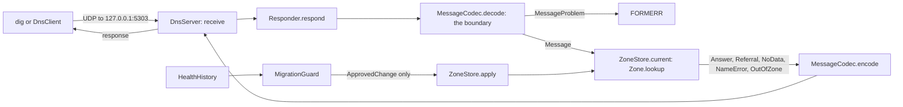

# Architecture

## The nine packages

| Package | What it owns |
|---|---|
| `config` | `SettingsReader`: typed values from a settings file, every missing or invalid key collected. No defaults anywhere. |
| `message` | The DNS wire format: `DomainName`, `RecordType`, `ResponseCode`, `RecordData`, `ResourceRecord`, `Question`, `Message`, `MessageProblem` and `MessageCodec`, the trust boundary for every packet. |
| `zone` | `ZoneFile` (the master-file format), `Weights` (CoreDNS's weights format), `Zone` (validation and lookup), `Lookup` (answer, referral, no data, no such name, out of zone) and `ZoneLoader`. |
| `migration` | `ZoneStore` (the zone a server answers from, and its audit log), `ApprovedChange`, `MigrationGuard` (the invariant), `HealthHistory`, `Publication`, `MigrationRefusal`. |
| `server` | `Responder` (one query packet in, one response packet out, no socket), `DnsServer` (UDP on 127.0.0.1), `ServeSettings` and `ServeCli`. |
| `resolver` | `Upstream`, `DnsClient` (UDP), `InMemoryUpstream` (the same bytes, no socket), `CachingResolver`, `CachePolicy`, `Resolution`, `LookupProblem`. |
| `sampling` | The weighted-routing test: `Sampler`, `SampleResult`, `SampleReport`, `SampleSettings`, `SampleCli`. |
| `experiment` | The TTL-change experiment: `SimulatedClock`, `Arm`, `ArmResult`, `ExperimentSettings`, `TtlSimulation`, `TtlExperimentCli`, and the live run: `LiveSettings`, `LiveMigration`, `SiteEndpoints`, `TtlLiveCli`. |
| `jdk` | `LabResolverProvider` and `LabResolver` (the JDK's resolver interface, pointed at the lab server) and `JdkLookupCli`. |

## The dependency rule

- `message` depends on nothing in this project. `zone` depends on `message`; `migration` on `zone` and `message`; `server` on `migration`, `zone` and `message`.
- `resolver` uses `server` only for `Responder` (in `InMemoryUpstream`) and `migration` only for `ZoneStore`.
- `sampling`, `experiment` and `jdk` sit on top; nothing depends on them except tests (the `migration` and `resolver` tests borrow `SimulatedClock`).
- The `*Cli` classes are the only code that prints or exits. Everything else returns values.

## The data flow of one query

## Walk-throughs

**A query for `www.seatwave.example`.** The server's one thread receives the packet, the `Responder` checks it is a query and not a response, the codec reads it, the zone finds a CNAME at `www`, follows it to the apex inside the zone and appends the A record, and the codec writes the answer with the authoritative flag set. Nothing is shared but the zone, which is immutable.

**A migration.** The guard reads the zone store's audit log to find the old TTL window (the longest TTL the name carried since its addresses last changed), asks the health history whether every old and new address passed its checks for the whole window, builds the changed zone and validates it like any other, and returns an `ApprovedChange`. The store applies it only if the zone has not changed since the approval. Retirement of the old address is approved only from the switch time plus twice the time until the last cached old answer can expire.

## Decisions and trade-offs

- **The JDK, not a DNS library.** The module teaches the wire format, so the codec is written by hand against RFC 1035, and its boundary checks are the point of the lesson. A production server would use a maintained one.
- **One port per zone.** The verification Mac has only 127.0.0.1 on its loopback interface; three addresses would need a network-settings change. Three ports keep the lab on the machine as it is.
- **One receiving thread.** Each packet takes microseconds, so one thread is enough and no queue can grow without bound; a production server spreads work over cores and sockets.
- **UDP only, 512 octets.** Truncation is flagged, TCP is not offered; a real server must answer over TCP too.
- **Weights in CoreDNS's format.** The same files drive both layers, so a result from one can be checked on the other.
- **A simulation and a live run.** Hours of TTLs are simulated on a clock that moves only when told to, through the same codec and `Responder` as the real server; the live run uses seconds-long TTLs on the wall clock, with real sockets and real health checks.

## Invariants, and where they are enforced

| Invariant | Where |
|---|---|
| No packet can make the decoder loop or read past its end | `MessageCodec.Decoder`: pointers strictly backward, every read bounds-checked, counts checked before any work |
| An invalid name, record or zone cannot exist | Compact constructors of `DomainName`, `ResourceRecord`, `RecordData`, `Message`; `Zone.of` is the only way to make a zone |
| No response to a response | `Responder.respond` drops it |
| No record change without healthy old and new addresses for the whole old TTL window | `MigrationGuard`; `ZoneStore.apply` takes only an `ApprovedChange`, whose constructor is package-private |
| No retirement of the old address before the old TTL has passed twice | `MigrationGuard.approveRetirement` |
| No query ever leaves the machine | `DnsServer` binds 127.0.0.1; `DnsClient` connects to 127.0.0.1; `LabResolver` refuses names outside `seatwave.example`; the script allows only 127.0.0.1 |
